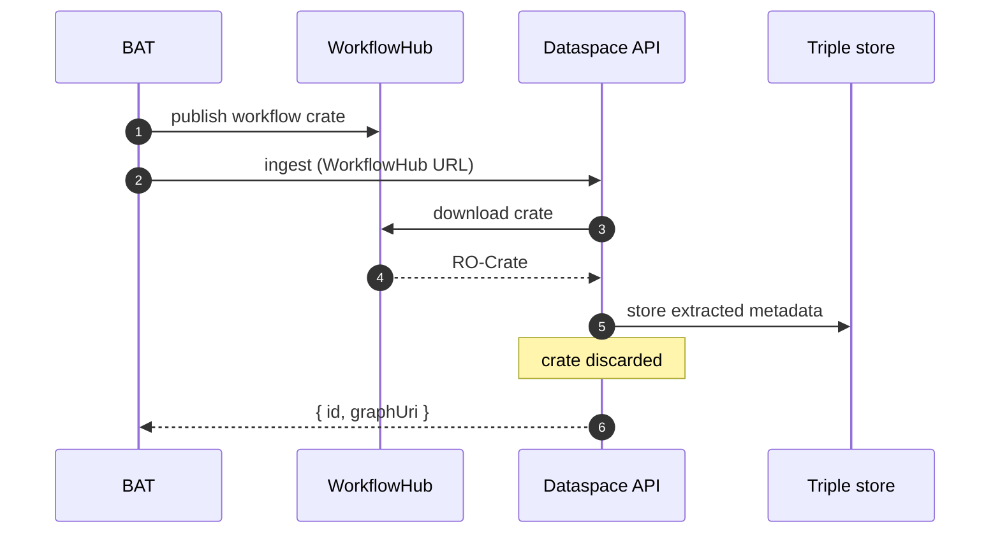
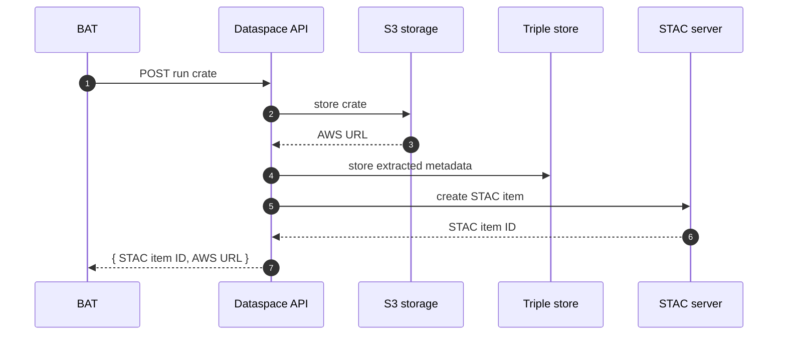
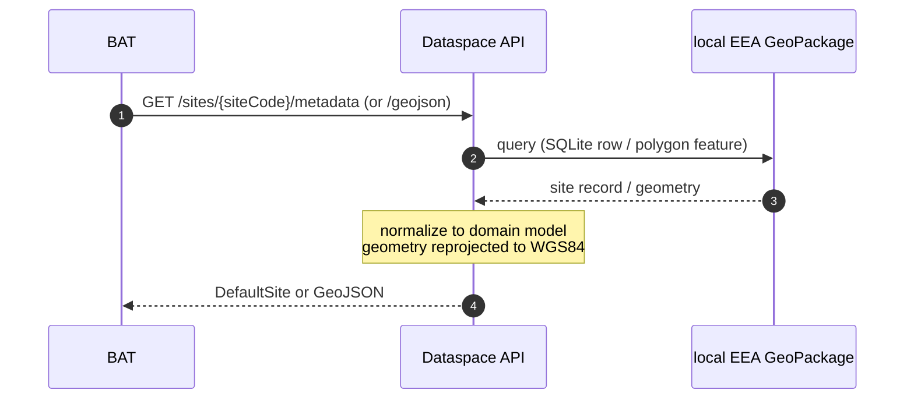
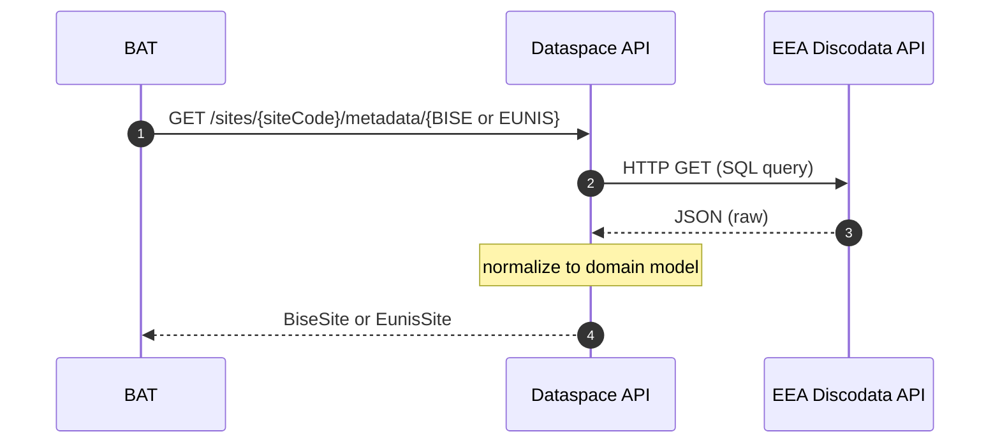
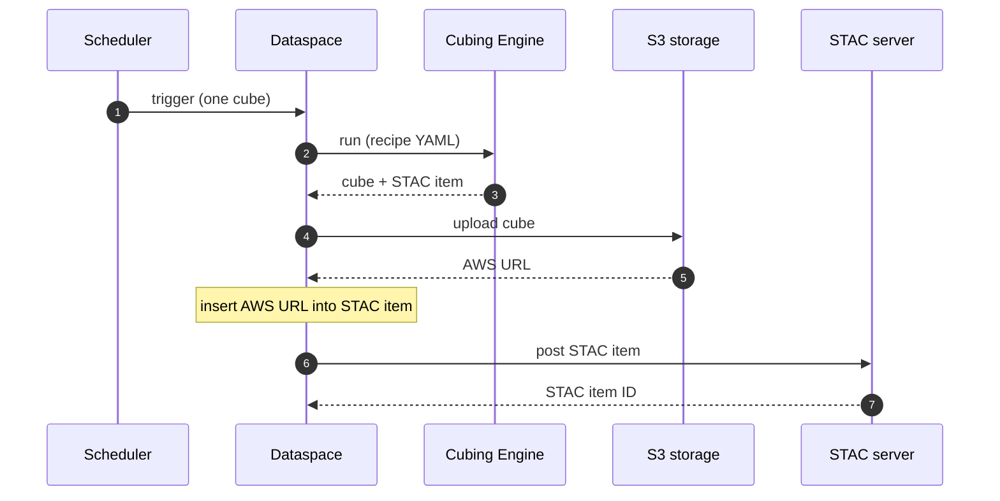
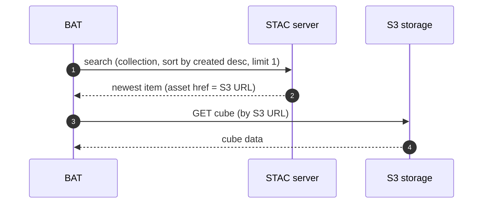
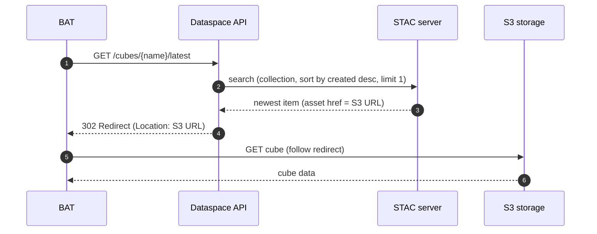
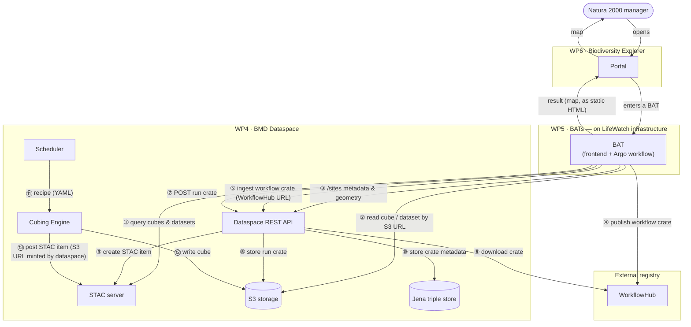

# BMD Dataspace — Architecture

## Status

| Authors:     | Ayco Holleman      |
|:-------------|:-------------------|
| First draft: | 2026-10-19         |
| Finalized:   |                    |
| Status:      | Feedback Requested |

## List of Abbreviations and Acronyms

|     |                             |
|:----|:----------------------------|
| BAT | Biodiversity Analysis Tools |
| BMD | Biodiversity Meets Data     |
| SDM | Species Distribution Model  |
| TBC | To Be Confirmed             |
| TBD | To Be Determined            |
| WP  | work package                |

## 1. Introduction

[Biodiversity Meets Data](https://bmd-project.eu/) (BMD) is an EU-funded project that aims to provide biodiversity
monitoring for Natura 2000 managers (the stakeholders). Its end product is a portal, the Biodiversity Explorer, in which
they can run species distribution models (SDMs). An SDM relates observed occurrences of a species to environmental
variables such as temperature and precipitation, and uses that relationship to estimate where the species occurs, or
could occur, under past, current or projected conditions.

BMD is split into eight work packages (WPs), each with its own deliverables. The BMD Dataspace is built in WP4. The work
packages most relevant for this document are listed below, in the order in which data flows through them.

* **WP3. The Cubing Engine.** The Cubing Engine turns heterogeneous source data (climate and satellite rasters, GBIF
  occurrence records, ...) into data cubes. A data cube is a multidimensional array in which each value is addressed by
  where (a grid cell), when (a point in time) and what (a species, or a climate variable such as temperature). An
  occurrence cube, for example, holds the number of observations per grid cell, per year, per species; a climate cube
  holds, say, the mean temperature per grid cell per month. Because all sources share the same grid and coordinate
  reference system, they can be compared and combined directly. Cubes are stored in cloud-optimized formats, so that an
  analysis can read just the slice it needs from very large datasets.
* **WP4. The BMD Dataspace.** The topic of this document.
* **WP5. The Biodiversity Analysis Tools (BATs).** The BATs provide the machinery to run the species distribution
  models. Each BAT also has its own frontend. For each type of ecosystem or "realm" a separate BAT is being developed
  (land species, marine species, ...). The BATs run on LifeWatch infrastructure, not on the dataspace; they obtain their
  input cubes from the dataspace's cloud storage (see §2).
* **WP6. The Biodiversity Explorer.** The portal through which Natura 2000 managers reach the BATs. There is no direct
  data exchange between the Explorer and the dataspace. Whether the Explorer also provides authentication and
  authorization for the dataspace is not yet settled.

## 2. BMD Dataspace — Overview

Generally, the BMD Dataspace provides storage and compute for the other components in the BMD project. Furthermore, the
BMD Dataspace provides services that benefit from being centralized, rather than being duplicated across the BATs. The
BMD Dataspace has the following responsibilities:

1. It hosts the Cubing Engine and runs it to generate a small number of large data cubes — too large to be generated by
   the BATs (their consumers) themselves. These cubes are created from relatively stable, but not entirely static data.
   Thus the BMD Dataspace will regenerate the cubes every so many months, perhaps annually.
2. It maintains the cloud storage used to store the cubes. AWS is currently the cloud storage provider. BATs have direct
   access to the AWS bucket. They read the cubes by means of their AWS URL. BATs can also upload their own data to the
   dataspace. This must then be accompanied by cataloging it in the STAC server (next item).
3. It hosts a [STAC server](https://bmd-stac.dryrun.link/) that provides metadata about the geospatial datasets used by
   the BATs. These _can_ be the datasets that end up in the dataspace, but they can also be located somewhere else
   (**TBC**).
4. It records provenance data about the outputs generated by the BATs.
5. It functions as a central place for various utilities needed by the BATs. These utilities are exposed through a REST
   API, called the [BMD Dataspace API](https://dataspace.bmdproject.eu/scalar).

_**NOTE**: Both the STAC server and the BMD Dataspace API are now accessed via provisional URLs under
**bmd-stac.dryrun.link** and **bmdproject.eu**, respectively. These domains are owned by Naturalis, not by the BMD
project. BATs must be prepared to switch over to the official BMD domain (**bmd-project.eu**) in due time._

## 3. Provenance — The RO-Crate Services

### Short Introduction to RO-Crates

If you already know what RO-Crates are, you can skip this section.

An [RO-Crate](https://www.researchobject.org/ro-crate/) is a standard way to package — inside a folder, often
distributed as a zip file — a result together with a machine-readable account of how it came about. It is closely
associated with the [Linked Open Data](https://en.wikipedia.org/wiki/Linked_data#Linked_open_data) world and addresses
the issue of the reproducibility of scientific results.

For BMD, the distinction that matters is between two kinds of crate:

* A **workflow crate** describes only the *method* used to convert a certain set of inputs to an output. It can be
  compared to a function _declaration_. It describes the type of the inputs and the output and provides a recipe (for
  example a [CWL file](https://www.commonwl.org/)) for turning the former into the latter. But it does not include
  concrete inputs and outputs.

* A **workflow run crate** describes an *actual execution* of the workflow. Besides the workflow description it _also_
  records the specific inputs that were used and the outputs that were produced — either embedded in the crate itself
  or, for large data, referenced by link (see below).

Only a run crate ties a result to its provenance, which is what lets a published map be justified later ("here is
exactly how this was computed, from these exact inputs"). This matters for the hosting question below, because
WorkflowHub — the external registry currently favored — is built primarily for the first kind, the reusable workflow
description, not for per-run records.

A second point concerns the inputs. A crate can either **contain** its input data or **point** to it using a web link.
BMD's inputs are data cubes that can run to many gigabytes, so packing them into every crate is impractical.
Realistically BMD's run crates will hold links. However, a link preserves reproducibility only for as long as it keeps
working *and* keeps pointing at the same bytes. If a cube is overwritten, then every crate that linked to that cube
quietly stops reproducing the original result. We will come back to this when we discuss
the [Cubing Engine](#cube-identity-and-immutability).

### RO-Crate Services provided by the BMD Dataspace

The following functionality is currently in place through
the [BMD Dataspace API](https://dataspace.bmdproject.eu/scalar):

1. Ingest an RO-Crate from a user-supplied URL
2. List the ingested crates
3. Retrieve the RDF graph for a crate (Turtle or JSON-LD)
4. Report the number of triples in a crate
5. Delete a crate

### BMD's Usage of RO-Crates

#### Workflow Crates

As a BAT produces the map requested by the end user, it also produces a workflow crate and publishes it
to [WorkflowHub](https://workflowhub.org/). It then requests the BMD Dataspace to ingest the RO-Crate by means of its
WorkflowHub URL. The BMD Dataspace downloads the RO-Crate and saves the extracted metadata to
an [Apache Jena](https://jena.apache.org/) triple store. The RO-Crate itself is subsequently discarded.



#### Workflow Run Crates

At the same time, the BATs also produce a Workflow _run_ crate. This crate contains _everything_ that is needed to
satisfy the end user's request — not just the map, but also, for example, any static HTML and JavaScript to wrap around
the map. These crates are saved directly to the BMD Dataspace, so the ingest-by-url endpoint of the BMD Dataspace API
cannot be used. The crates must be POSTed directly to the API. This could prove to be a very costly detour, given that
the crate will ultimately have to end up on the dataspace's S3 storage. Perhaps the BATs should only send the RO-Crate
metadata (rocrate-metadata.json) to the API while sending the crate itself directly to the S3 storage. Nevertheless, for
now we **propose** that BATs post the run crates to the API. The dataspace will then update the triple store, create a
STAC item, and forward the RO-crate to S3 storage. In return the BAT will receive a JSON object containing the STAC item
ID and the AWS URL.



### Open questions

1. **Purpose.** The ingested graphs can be retrieved through the API, but who reads them back, and for what purpose?
   Being able to read back a single graph (i.e. a single crate) is likely not very useful anyway. How are we going to
   search and aggregate over the data in the triple store? **TBD**.

## 4. Discovery — The STAC Catalog

### Short Introduction to STAC

If you already know what STAC is, you can skip this section.

[STAC](https://stacspec.org/) (SpatioTemporal Asset Catalog) is a standard for describing geospatial datasets and making
them searchable. A STAC _item_ records metadata about a dataset — its spatial and temporal boundaries, its license, and
links to the actual files. The files themselves live elsewhere (typically object storage). A STAC server is therefore a
searchable index over data held elsewhere, not a data store in its own right.

### The BMD STAC Server

The BMD Dataspace hosts an [open-source STAC server](https://github.com/stac-utils/stac-server) supporting version 1.1
of the [STAC API](https://github.com/radiantearth/stac-api-spec). Again, the STAC server now operates under a
provisional domain (`bmd-stac.dryrun.link`) and is expected to move to the official BMD domain (`bmd-project.eu`). BATs
populate the STAC server via the STAC API. A [separate web browser](https://stac-view-quest.base44.app/) for the catalog
(STAC Explorer) exists as a demo instance.

#### Usage by the BATs

The BATs have direct write access to the STAC server. While the data cubes produced by the Cubing Engine are important
inputs for the BAT workflows, they are not the _only_ inputs. BATs are free to record any datasets required to do their
work. The datasets themselves will generally live on the S3 storage provided by the BMD Dataspace, but this is not
required. **TBC**.

#### Usage by the Dataspace Itself

The BMD Dataspace is responsible for running the Cubing Engine. Besides the data cubes, the Cubing Engine will also
output a JSON file representing a STAC item. The dataspace will send the data cube to S3 and post the STAC item to the
STAC server.

### Open questions

1. **Overlap with `/sites` endpoint.** Why is data already served per site by the `/sites` endpoints of the BMD
   Dataspace API (EEA/BISE/EUNIS) _and_ additionally cataloged as bulk files on STAC?
2. **Write access.** Who may add or modify items on the STAC server, and how is that authenticated?
3. **Garbage Collection.** The BMD Dataspace does not curate or validate the contents in any way. There is no mechanism
   in place for verifying that items posted to the STAC server conform to
   the [guidelines](https://github.com/Biodiversity-Meets-Data/STAC-collections/blob/main/bmd-guidelines.md). There are
   in fact already items in the STAC server which do not comply with the licensing guidelines. There is also no
   mechanism in place to verify the liveness of the STAC items (items reference datasets that no longer exist; dead URLs
   in STAC items). How do we prevent the STAC server from becoming a junkyard?

## 5. Utilities — Site Metadata and Geometry

Besides the services described above, the BMD Dataspace API exposes a number of utility endpoints: small, read-only
services that save every BAT from re-implementing the same lookups.

At present there is one such service: **site service**. Natura 2000 sites are identified by a site code. Given such a
code, the site service returns:

* the site's **metadata**, from any of three sources — EEA, BISE, or EUNIS;
* the site's **geometry** as GeoJSON

An [index](https://dataspace.bmdproject.eu/sites/index) of all known sites is also available. It maps site names to site
codes — useful if you know the name but not the code.

#### Site service — EEA



#### Site service — BISE / EUNIS



## 6. Running the Cubing Engine

The dataspace is responsible for running the Cubing Engine to produce the data cubes introduced in §1. The Cubing Engine
creates a cube based on a so-called "recipe", which is encoded in YAML. So: YAML in; cube out. Besides the data cube, the
Cubing Engine also generates a JSON file representing a STAC item — ready to be posted to the STAC server.

### Proposed Mechanism

The basic mechanism is simple. The dataspace maintains a small registry of Cubing Engine "recipe" files. The recipe
files are created by BAT developers, based on their needs. They also specify the frequency with which the cube is
regenerated.

For each cube, a job scheduler invokes the Cubing Engine with the appropriate recipe file. The dataspace then stores the
cube on its S3 storage and posts the STAC item to the STAC server ([§4](#4-discovery--the-stac-catalog)).

There is one subtlety. The access URL under which a cube becomes available is minted by the dataspace, not by the Cubing
Engine. The dataspace must therefore edit the STAC item produced by the engine to insert that URL before posting it.



### Cube Identity and Immutability

We **propose** that **data cubes are never overwritten**. Again, if a cube is overwritten, then all crates that linked
to a previous version of the cube stop reproducing the original result. This is hard to reconcile with the rest of the
project: it would be incoherent to engage the sternness of RO-Crates and Linked Open Data for the sake of reproducible
provenance, only to overwrite the very cubes that the provenance depends on.

Thus, we **propose** that each regeneration of a cube is written under a new URL and recorded as a new STAC item
(containing a checksum). This impacts, however, how BATs should get hold of a cube. So far, they have been using static
S3 URLs to retrieve files from the dataspace's S3 storage. Instead, the AWS URL should now be resolved via the STAC
server. The following paragraphs provide options for BATs on how they can achieve this.

#### STAC-native Resolution

Resolving a cube can be as simple as a single search call against the STAC server if we use the following model:

* A **logical cube** is a STAC Collection. A STAC Collection has a stable `id` (for example `chelsa-bioclim-eu`). This
  id never changes, however often the cube is regenerated — it is the cube's permanent name.
* A **concrete cube** is a STAC Item in that collection. It contains a `created` timestamp that allows us to pick the
  one we want:

```
POST /search
{
  "collections": ["chelsa-bioclim-eu"],
  "sortby":      [{ "field": "created", "direction": "desc" }],
  "limit":       1
}
```

The returned item specifies the S3 URL in `item.assets.data.href`. The BAT would read it and carry on as before.



#### A Resolver Endpoint

The Dataspace API can wrap the query behind a single endpoint — for example `GET /cubes/{name}/latest`, which would
redirect to the correct AWS URL. This way, BAT developers could, in effect, keep using static URLs, except they are now
Dataspace API URLs. Note that the BATs call a dataspace API endpoint, but the cube's bytes directly come from AWS — no
costly detour via the dataspace API.



### Open questions

1. **Which cubes, and how many?** We are halfway through the BMD project, and it is still not established which cubes
   the dataspace should generate — nor even how many. This is a prerequisite for everything else in this chapter, and
   currently the most pressing open question. **TBD**.

2. **Immutability and its cost.** We propose cubes are never overwritten. Immutability, however, is not free:
   every regeneration adds a version that is never deleted, so storage grows without bound. A retention policy remains
   to be decided. **TBD**.

## 7. Flow Chart

The preceding chapters each describe one service in isolation. This final chapter brings them together in a single
picture: who talks to whom, and what flows between them. The key architectural point to take from it is the split
between _discovery_ and _data_ — a BAT finds out which cube it needs by querying the STAC catalog, but reads the cube's
bytes directly from S3 — and the fact that the BMD Dataspace is, throughout, a _called_ service: the BATs drive the
interaction, the dataspace responds.



**Discovery** (①–③). To run an analysis, a BAT first asks the STAC catalog which cubes and reference datasets it needs
(①) and gets back, per item, the S3 URL of the actual file. It then reads those files directly from S3 (②). For per-site
information it calls the `/sites` utility on the Dataspace API (③).

**Provenance** (④–⑩). For the workflow crate, the BAT publishes it to WorkflowHub (④) and asks the Dataspace to ingest
it by its WorkflowHub URL (⑤), whereupon the Dataspace downloads it (⑥). The run crate — which carries the actual
result, including the static HTML shown to the user — is instead POSTed to the Dataspace API (⑦), which stores it in S3
(⑧) and creates a STAC item for it (⑨). In both cases the extracted metadata is written to the triple store (⑩).

**Cube Production** (⑪–⑬). Internally, a scheduled job runs the Cubing Engine against a recipe (⑪). The engine writes
the cube to S3 (⑫) and produces a STAC item, which the Dataspace posts to the catalog after minting the cube's S3 URL
(⑬). From then on the cube is discoverable through step ①.